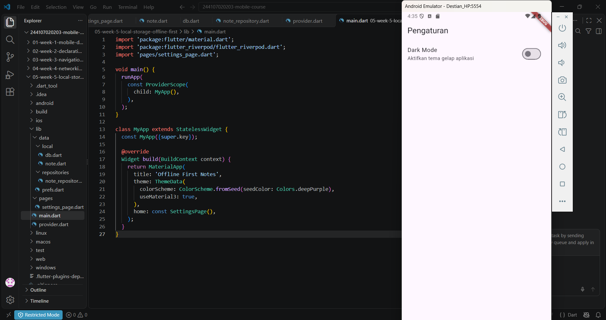
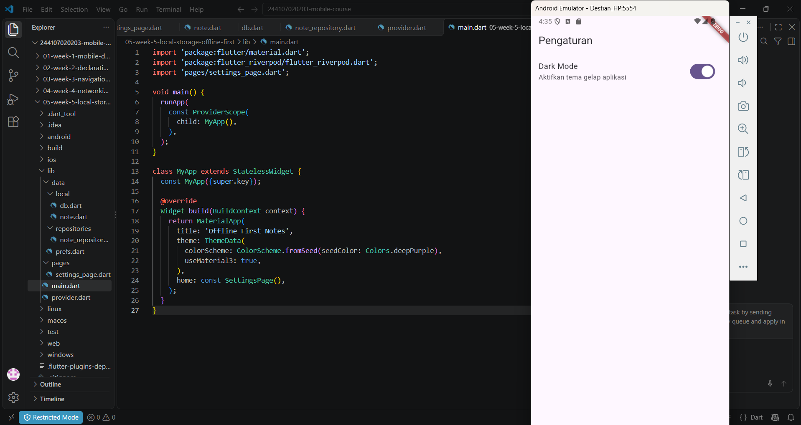
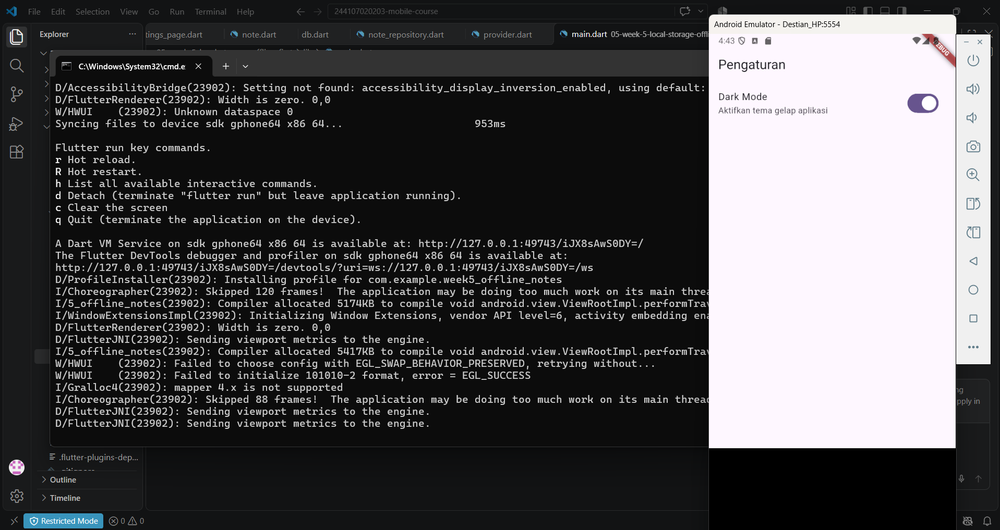
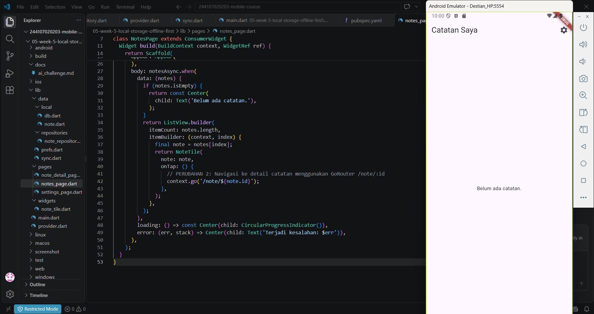
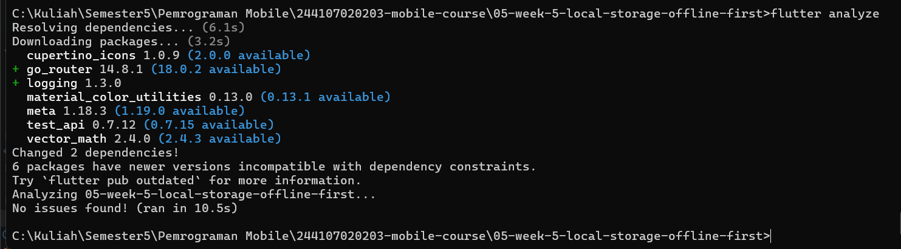
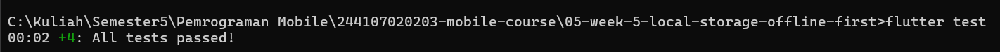

# Laporan Praktikum Pemrograman Mobile - Week 5
## Local Storage & Offline-First (Offline Notes)

* **Nama:** Destian Dwi Hardika
* **NIM:** 244107020203
* **Kelas:** TI-2F
* **Program Studi:** D4 Teknik Informatika
* **Institusi:** Politeknik Negeri Malang

---

## 1. Praktikum 1 — SharedPreferences & Pengaturan
Praktikum ini membahas pemanfaatan plugin `shared_preferences` untuk menyimpan data preferensi pengguna berformat *key-value* secara lokal, seperti pengaturan tema gelap/terang (*dark mode*) dan penyimpanan informasi waktu terakhir aplikasi dibuka (*last opened*).

* **Screenshot Hasil Praktikum 1:**
  

---

## 2. Praktikum 2 — SQLite dan Repository Catatan
Praktikum ini berfokus pada pengelolaan basis data relasional lokal menggunakan SQLite (`sqflite`). Di sini diterapkan struktur model data `Note` (berisi *id*, *title*, *body*, *updatedAt*, dan *dirty*) serta `NoteRepository` sebagai pengelola operasi *Create, Read, Update, Delete* (CRUD) dan pengurutan catatan berdasarkan pembaruan terbaru.

* **Screenshot Sebelum Sinkronisasi (Menampilkan Badge Dirty):**
  

* **Screenshot Sesudah Sinkronisasi:**
  

---

## 3. Praktikum 3 — Cache-first dan Antrean Sync
Praktikum ini menerapkan konsep arsitektur *Offline-First* dengan pendekatan *Cache-First*. Data dibaca dari penyimpanan lokal SQLite terlebih dahulu untuk akses cepat secara offline, sementara perubahan lokal ditandai menggunakan *dirty flag* (`dirty = 1`) sebelum disinkronkan kembali.

* **Screenshot Hasil Praktikum 3:**
  

---

## 4. Hasil Refactoring

### A. Flutter Analyze (`G5_FAnalyze`)
Analisis statis kode untuk memastikan kode sumber bersih dari error dan warning.

### B. Flutter Test (`G6_Ftest`)
Pengujian unit dan provider untuk memvalidasi model dan logika penyimpanan.
