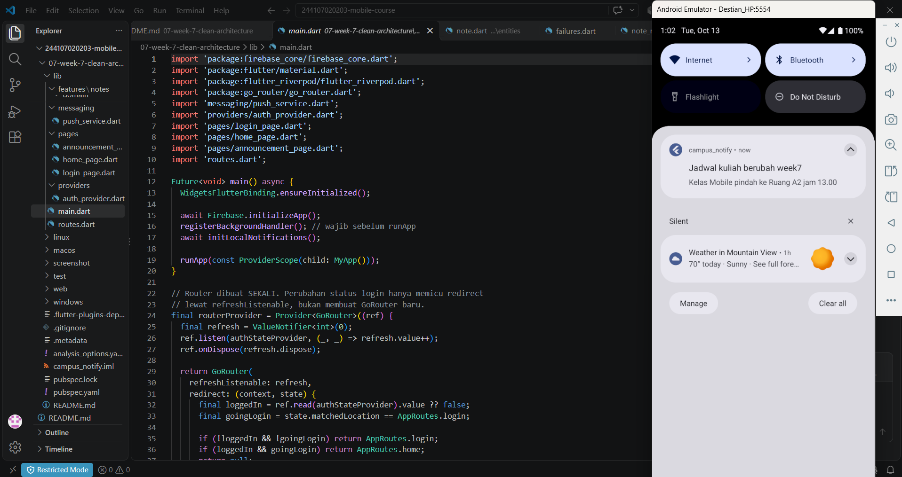
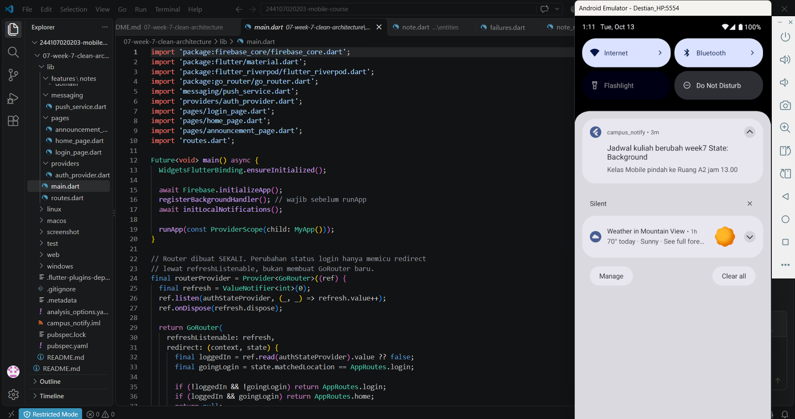
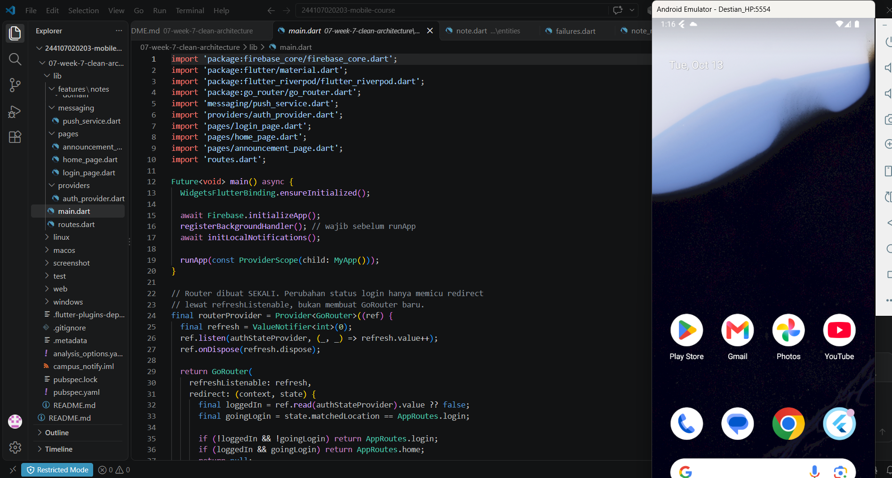

# 📱 week-7-clean-architecture

<details>
<summary><b>📖 Klik untuk Membuka Detail Laporan Praktikum</b></summary>

## 👤 Identitas Mahasiswa
* **Nama**: Destian Dwi Hardika
* **NIM**: 244107020203
* **Kelas / Absen**: TI-2F / 06
* **Jurusan / Program Studi**: Teknologi Informasi - Diploma IV Teknik Informatika
* **Institusi**: Politeknik Negeri Malang

---

## Deskripsi proyel

## Praktikum 1: Audit Layer Project Lama

Project dasar: `campus_notify` (week 6). Snapshot: `chore: snapshot before clean architecture`.

### 1. Petakan file ke layer

| File | Layer saat ini | Masalah |
|---|---|---|
| `pages/home_page.dart` | presentation | Import `firebase_messaging`; 2 panggilan `FirebaseMessaging.instance` di `onPressed` (baris 117, 129); `requestNotificationPermission` dan `initFcmToken` dipanggil dari `initState`; topik `'pengumuman-kampus'` di-hardcode 3 kali |
| `pages/login_page.dart` | presentation | Bersih, hanya memakai `auth_provider` |
| `pages/announcement_page.dart` | presentation | Bersih, widget murni tanpa logika/data |
| `providers/auth_provider.dart` | presentation (state) | `TokenStore()` dan `AuthRepository()` dibuat manual (baris 5-6); orkestrasi login/logout ada di notifier; mengimpor kelas konkret dari data |
| `data/auth_repository.dart` | data (+kontrak tercampur) | Interface dan implementasi satu kelas; entity `AuthSession` dan validasi input ikut di file ini |
| `data/api_errors.dart` | data | `AppException` adalah error domain, kandidat pindah ke `core/failures.dart` |
| `data/token_store.dart` | data | Sumber data lokal, belum ada kontrak/interface |
| `data/api_client.dart` | data | OK bila hanya dipakai repository (belum diverifikasi) |
| `messaging/push_service.dart` | data/infrastruktur | Fungsi top-level + state global; mencampur FCM, notifikasi lokal, dan navigasi; import `routes.dart`; auto-subscribe topik di `initFcmToken` |

### 2. Tiga pelanggaran klasik (hasil pencarian)

Perintah dijalankan dengan `findstr` (padanan `rg` di Windows), satu path per perintah.

| Pencarian | Hasil |
|---|---|
| #1 Jaringan/DB langsung di widget (`lib\pages`, `lib\providers`) | Nol temuan |
| #2 Logika bisnis di `build()` (`lib\pages`) | Nol temuan |
| #3 Instansiasi manual (`lib\providers`) | `auth_provider.dart:6` → `AuthRepository()` |

Temuan tambahan (manual, di luar pola jobsheet):
- `auth_provider.dart:5` → `TokenStore()` dibuat manual.
- `home_page.dart:4` → import `firebase_messaging` di widget.
- `home_page.dart:117, 129` → `FirebaseMessaging.instance.subscribeToTopic/unsubscribeFromTopic` dari widget.
- `home_page.dart:25-35` → inisialisasi push (`requestNotificationPermission`, `initFcmToken`) dari `initState`.
- `push_service.dart:108` → `initFcmToken` men-subscribe topik otomatis, sehingga tombol Subscribe di UI redundan (dicatat saja, perilaku tidak diubah).

Catatan: `findstr` yang diberi dua path sekaligus melewatkan folder `providers`, jadi pencarian dijalankan ulang per folder.

### 3. Struktur target (fitur `auth`)

```
lib/
├── core/
│   ├── failures.dart                  # dari data/api_errors.dart
│   └── providers.dart                 # provider lintas fitur (opsional)
├── features/
│   ├── auth/
│   │   ├── domain/
│   │   │   ├── entities/auth_session.dart
│   │   │   ├── repositories/auth_repository.dart      # interface
│   │   │   └── usecases/
│   │   │       ├── login_user.dart
│   │   │       ├── logout_user.dart
│   │   │       └── check_session.dart
│   │   ├── data/
│   │   │   ├── datasources/token_store.dart
│   │   │   └── repositories/auth_repository_impl.dart
│   │   └── presentation/
│   │       ├── providers/auth_providers.dart          # notifier + DI
│   │       └── pages/login_page.dart
│   └── announcements/                 # fitur kedua (push + topik), bila sempat
│       └── ...
└── routes.dart                        # GoRouter + konstanta rute
```
## Praktikum 2: Domain dan Data Per Fitur

Implementasi Clean Architecture untuk mendefinisikan *Enterprise Business Rules* (Domain) dan pemrosesan data (Data) secara terpisah, mandiri dari dependensi UI/Framework.

### 1. Struktur File yang Dibuat

Pada praktikum ini, telah dibuat struktur layer `domain` dan `data` untuk fitur `notes` dan/atau `auth`:

### 2. Penjelasan Hasil Refactoring & Fitur Utama

* **`core/failures.dart`**: Menyiapkan penanganan error yang aman (*type-safe*) menggunakan `sealed class Failure` (`LocalFailure` dan `NetworkFailure`). Mengisolasi error teknis agar tidak bocor dalam bentuk *exception* mentah ke tampilan UI[cite: 7, 8].
* **Pure Entity (`domain/entities/note.dart`)**: Mendefinisikan objek bisnis murni `Note` tanpa ketergantungan pada *framework* Flutter maupun library pihak ketiga[cite: 6].
* **Abstraction & Inversion of Control (`domain/repositories/note_repository.dart`)**: Membuat kontrak interface `NoteRepository` yang mengembalikan tipe data *Record* Dart `({T data, Failure? failure})` untuk penanganan status berhasil/gagal secara eksplisit[cite: 7].
* **Data Mapper (`data/models/note_model.dart`)**: Bertanggung jawab penuh menangani *serialization/deserialization* data lokal (SQFlite / JSON) dari dan ke format Entity domain[cite: 8].
* **Concrete Repository (`data/repositories/note_repository_impl.dart`)**: Mengimplementasikan kontrak interface `NoteRepository` untuk mengeksekusi *query* database lokal SQFlite secara terisolasi[cite: 8, 9, 10].
* **Use Case (`domain/usecases/get_notes.dart`)**: Membungkus operasi pengambilan daftar catatan ke dalam satu fungsi bisnis tunggal (`call()`)[cite: 11].

---

### 3. Ringkasan Pencapaian Praktikum 2

| Komponen Layer | Hasil Implementasi | Manfaat Utama |
|---|---|---|
| **Domain (Entity & Contract)** | Terisolasi murni Dart | Bebas dari dependensi UI dan database, mudah diuji secara mandiri (*unit testing*)[cite: 6, 7]. |
| **Data (Model & Impl)** | Terkapsulasi di layer `data` | Perubahan sumber data (misal: ganti ke Hive/REST API) tidak mempengaruhi UI atau logika bisnis[cite: 8, 9, 10]. |
| **Error Handling** | Menggunakan *Record* + `Failure` | Mencegah *app crash* akibat *unhandled exception*[cite: 7, 8]. |

---

## Praktikum 3: Implementasi Presentation Layer

Praktikum 3 berfokus pada implementasi *Presentation Layer* dalam Clean Architecture pada proyek Campus Notify. Layer ini bertanggung jawab mengelola tampilan antarmuka pengguna (UI), state aplikasi, serta interaksi pengguna dengan fitur yang tersedia.

### 1. Hasil Screenshot Praktikum 3

Berikut dokumentasi hasil pengerjaan Praktikum 3:

#### Gambar 1 — Implementasi Presentation Layer


#### Gambar 2 — Implementasi State Background


#### Gambar 3 — Implementasi State Terminated


#### Gambar 4 — Implementasi State Terminated


---

## AI Challenge: Campus Notify Clean Architecture

Dokumentasi AI Challenge berisi proses analisis dan usulan refactoring arsitektur Campus Notify menggunakan bantuan AI. Pembahasan mencakup pemetaan file lama ke struktur Feature-First Clean Architecture, pemisahan layer `presentation`, `domain`, dan `data`, evaluasi penggunaan use case, serta penerapan Dependency Injection (DI) menggunakan Riverpod.

Dokumentasi lengkap AI Challenge tersedia di folder [`docs`](docs/).

---

## Refactoring: Evaluasi dan Penyempurnaan Clean Architecture

Bagian refactoring berfokus pada evaluasi dan penyempurnaan struktur kode setelah penerapan Clean Architecture. Proses ini dilakukan untuk memastikan pemisahan tanggung jawab antarlayer berjalan dengan baik serta mengurangi ketergantungan yang tidak diperlukan.

### 1. Tujuan Refactoring

- Memastikan kontrak repository berada pada layer `domain` dan implementasinya berada pada layer `data`.
- Memisahkan entity dari model yang bertanggung jawab atas serialisasi dan deserialisasi data.
- Memusatkan pengelolaan dependensi melalui provider Riverpod.
- Memastikan widget tidak membuat repository secara manual atau mengakses layanan teknis secara langsung.
- Memeriksa kualitas kode menggunakan `flutter analyze`.
- Memastikan pengujian otomatis dapat dijalankan menggunakan `flutter test`.

### 2. Hasil Screenshot Refactoring

#### Gambar 1 — Hasil Flutter Analyze

Screenshot berikut menunjukkan hasil pemeriksaan statis kode menggunakan perintah `flutter analyze`.


#### Gambar 2 — Hasil Flutter Test

Screenshot berikut menunjukkan hasil pengujian otomatis menggunakan perintah `flutter test`.


### 3. Kesimpulan Refactoring

Refactoring dilakukan untuk meningkatkan kualitas struktur kode, menjaga konsistensi penerapan Clean Architecture, serta mempermudah proses pengujian dan pemeliharaan aplikasi Campus Notify. Pemeriksaan melalui `flutter analyze` dan `flutter test` digunakan sebagai bagian dari verifikasi hasil refactoring.
