# 📱 Campus Notify - Laporan Modul Pemrograman Mobile

<b>📖 Klik untuk Membuka Detail Laporan Praktikum</b>

## 👤 Identitas Mahasiswa
* **Nama**: Destian Dwi Hardika
* **NIM**: 244107020203
* **Kelas / Absen**: TI-2F / 06
* **Jurusan / Program Studi**: Teknologi Informasi - Diploma IV Teknik Informatika
* **Institusi**: Politeknik Negeri Malang

---

## 📌 Deskripsi Proyek
**Campus Notify** adalah aplikasi mobile berbasis Flutter yang dikembangkan untuk membantu sivitas akademika menerima informasi dan pengumuman kampus secara *real-time*. Aplikasi ini mengintegrasikan **Firebase Cloud Messaging (FCM)** untuk pengiriman *push notification*, sistem autentikasi pengguna yang aman menggunakan **Flutter Riverpod** sebagai manajemen state, serta navigasi modern berbasis *deep-link* menggunakan **GoRouter**.

---

## ⚡ Fitur-Fitur Utama Aplikasi
* **Sistem Autentikasi & Route Guard**: Membatasi akses halaman berdasarkan status login pengguna, memastikan hanya pengguna terautentikasi yang dapat masuk ke beranda dan detail pengumuman.
* **Integrasi Firebase Cloud Messaging (FCM)**: Menerima, memproses, dan menampilkan notifikasi kampus secara instan pada berbagai kondisi aplikasi (*foreground*, *background*, hingga *terminated*).
* **Navigasi Notifikasi Dinamis (`routeFromMessage`)**: Fitur cerdas untuk memparsing *payload* data notifikasi agar pengguna langsung diarahkan ke halaman detail pengumuman yang dituju secara akurat.
* **Manajemen State Modern**: Menggunakan Flutter Riverpod untuk menjaga reaktivitas status autentikasi dan sinkronisasi rute secara efisien.
* **Pengujian Komprehensif (Testing)**: Dilengkapi dengan *Unit Testing* untuk menguji logika parsing payload FCM & token, serta *Widget Testing* untuk memastikan integritas antarmuka aplikasi.

---

## 🤖 AI Challenge
* **Deskripsi**: Bagian tantangan kecerdasan buatan yang mendokumentasikan proses eksplorasi pemecahan masalah, penyusunan *prompt*, serta strategi optimasi kode dalam pengembangan fitur keamanan dan notifikasi FCM.
* **Dokumentasi**: Laporan lengkap mengenai tantangan ini telah diarsipkan dan disimpan secara terstruktur di dalam folder `docs/ai-challenge-report.md`.

---

## 🚀 Tahapan Praktikum & Hasil Eksekusi

### 1. Praktikum 1: Inisialisasi Proyek & Setup Firebase
* **Deskripsi**: Melakukan konfigurasi awal proyek Flutter dan menghubungkannya dengan layanan Firebase.
* **Hasil SS Praktikum**:

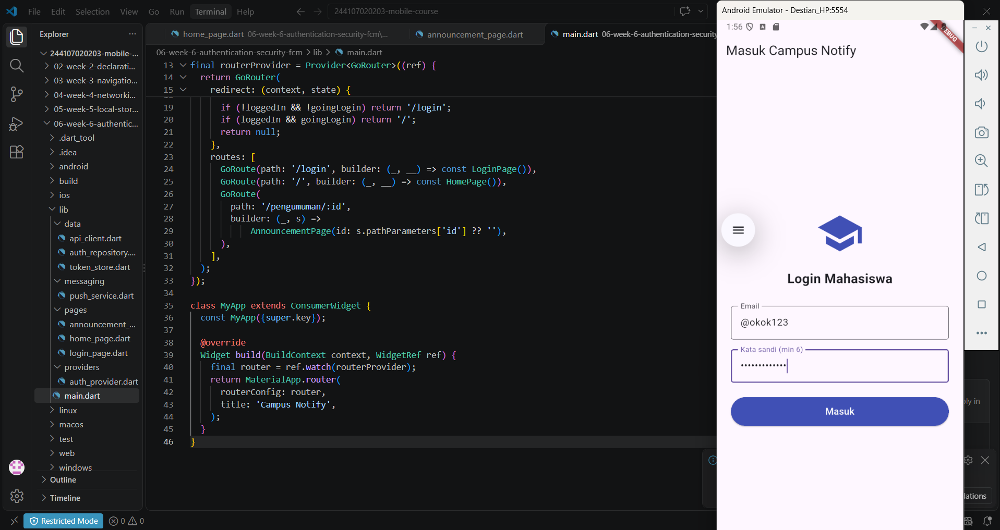

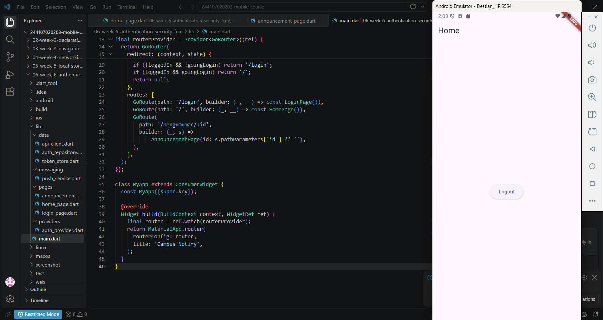

---

### 2. Praktikum 2: Implementasi Autentikasi & State Management
* **Deskripsi**: Membangun halaman login, manajemen status autentikasi menggunakan Riverpod, dan proteksi rute halaman menggunakan GoRouter.
* **Hasil SS Praktikum**:

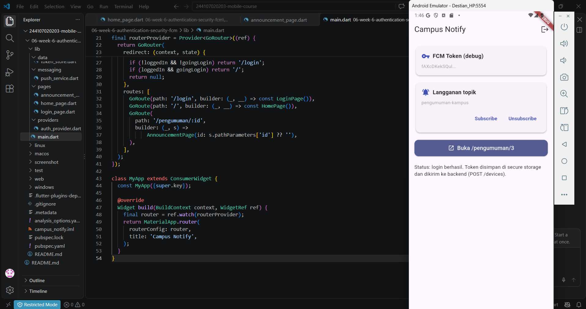

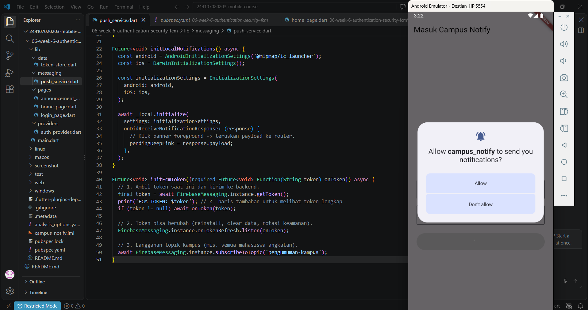

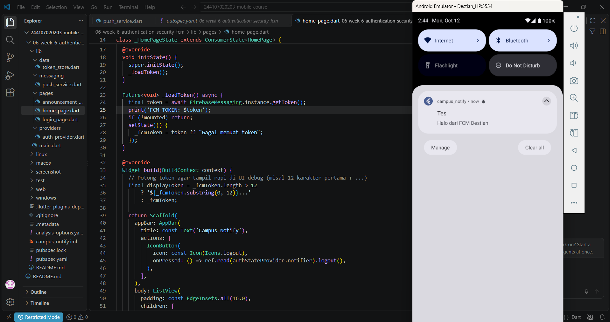

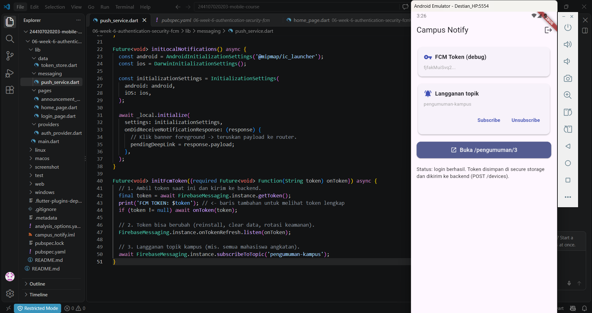

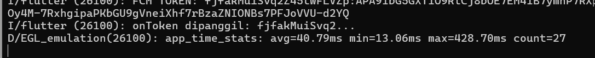

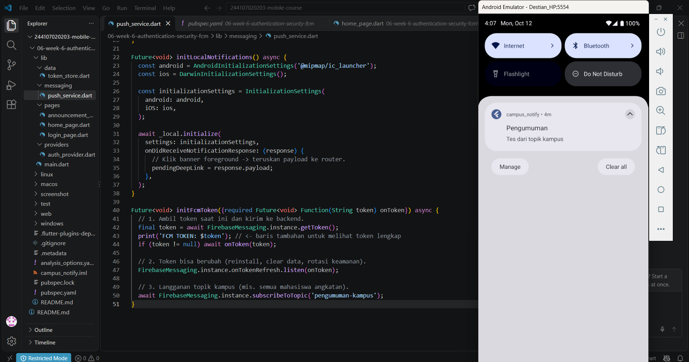

---

### 3. Praktikum 3: Integrasi Firebase Cloud Messaging (FCM)
* **Deskripsi**: Mengonfigurasi penanganan pesan *push notification* pada kondisi *foreground*, *background*, dan *terminated*.
* **Hasil SS Praktikum**:

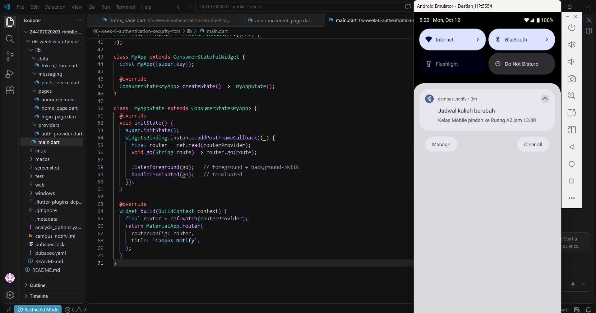

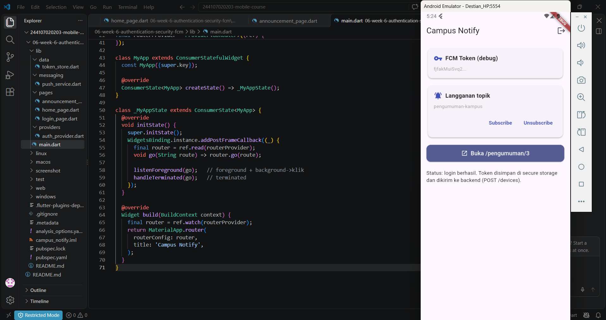

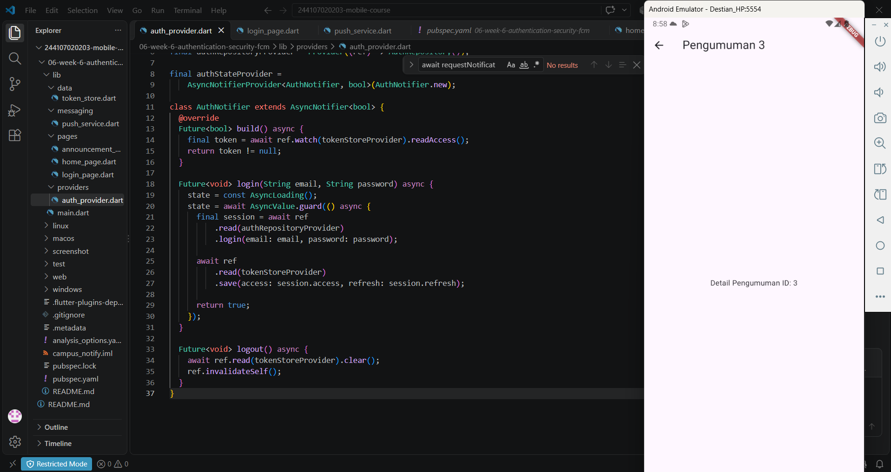

---

### 4. Refactoring & Testing (Analisis & Pengujian)
* **Deskripsi**: Melakukan perbaikan rute, struktur kode, analisis statis, serta eksekusi unit dan widget test.
* **Hasil SS Praktikum**:

* **Flutter Analyze**:
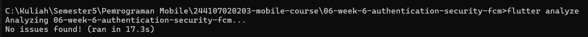

* **Flutter Test**:
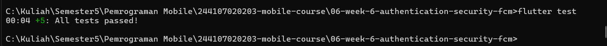

---

## 🧪 Kesimpulan Pengujian
* **Flutter Analyze**: Berhasil melewati analisis statis tanpa error kritis.
* **Flutter Test**: Seluruh skenario *unit test* dan *widget test* berhasil lolos (*Passed*).

---

